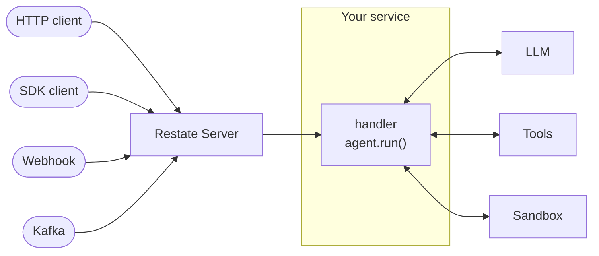

Restate agentlib (`@restatedev/agentlib`) is an agent harness for TypeScript, built directly on Restate's durable execution.
You define an agent with a model, instructions, and tools, and run it in a Restate service handler.
agentlib runs the agent loop, and Restate journals every model call and the durable steps of each tool call, so a run continues after a crash without repeating completed calls.

agentlib builds on Restate's building blocks: durable handlers, [Durable Coroutines](/develop/ts/concurrent-tasks#durable-coroutines), [Virtual Objects](/foundations/services#virtual-object), and durable service calls.
The agent, its sub-agents and tools, and the workflows that it starts run on one durable runtime, so they call each other reliably, suspend while they wait, and you inspect all of them in the Restate UI.
Because agentlib is a thin layer on these building blocks, you can customize it, or use its source as a reference for building your own harness.

## When to use agentlib

Use agentlib when you build an agent or an agent platform in TypeScript and want the agent loop and your application logic in one durable program, which can also use state, service calls, timers, and workflows.

- To keep an agent framework that you already use, such as the Vercel AI SDK or the OpenAI Agents SDK, use an [agent SDK integration](/ai#agent-sdk-integrations).
- To write the agent loop yourself, or to build in another language, use a [custom harness](/ai#build-your-own-harness).

## How it works

You define an agent once, at module scope, with `agent()`, and a handler runs it with `yield* agent.run(input)`:

```typescript {"CODE_LOAD::agentlib/src/agents.ts#overview"} 
const assistant = agent({
  model,
  instructions: "Answer support questions briefly.",
  maxSteps: 6,
});

export const support = restate.service({
  name: "Support",
  handlers: {
    *ask(question: string) {
      const result = yield* assistant.run(question);
      if (result.status !== "completed") return result.output ?? result.reason;
      return result.output;
    },
  },
});
```

Each request to `Support/ask` starts a run: a loop of model calls and the tool calls that the model requests.
The handler controls everything around the run, such as where the conversation is stored, who approves tool calls, and what happens with the result.



If you interrupt the run or cancel the invocation, agentlib cancels the run's unfinished tool calls.

## Features

| Feature | Description |
|---|---|
| [Models](/agentlib/models) | OpenAI, Anthropic, Amazon Bedrock, Google, and other Vercel AI SDK providers, or your own client. Includes retries, prompt caching, reasoning, and token usage. |
| [Typed output](/agentlib/agents#typed-output) | Final answers validated against a Zod schema |
| [Tools](/agentlib/tools) | Async functions with journaled results, generator functions that compose Restate operations, and Restate handlers as tools |
| [MCP tools](/agentlib/tools#mcp-servers) | The tools of an MCP server, loaded in a handler |
| [Tool search](/agentlib/tools#tool-search) | Tools that stay hidden until the model searches for them, for large tool catalogs |
| [Code mode](/agentlib/tools#code-mode) | JavaScript programs that call several tools in a sandbox |
| [Background tools](/agentlib/tools#background-tools) | Tool calls that run while the model continues |
| [Skills](/agentlib/agents#skills) | Instructions that the model loads when a task needs them |
| [Sessions](/agentlib/sessions) | Conversation history per Virtual Object key, stored in chunks, with optional compaction |
| [Context window](/agentlib/sessions#context-window) | Tool result previews, compaction, and truncation for long runs |
| [Human approval](/agentlib/human-approval) | Tool calls that wait for a person's decision, even days later |
| [Guardrails](/agentlib/guardrails) | Checks and redaction for input, tool calls, tool output, and answers |
| [Steering and interruption](/agentlib/steering-and-progress#steering-and-interruption) | New input for a running agent, or a stop with a summary |
| [Progress events and streaming](/agentlib/steering-and-progress#progress-events) | Run events and model text for clients |
| [Multi-agent](/agentlib/multi-agent) | Routing, review loops, races, worker services, sub-agents, handoffs, and forks |
| [Limits](/agentlib/agents#limits) | Maximum steps, tool calls, nesting depth, and output size per run |
| [Error handling](/agentlib/error-handling) | Failures that the model sees, and failures that stop the run |
| [Testing](/agentlib/testing) | Fixture models and forced replay against a real Restate Server |

## Key concepts

| Term | Meaning |
|---|---|
| Agent definition | Reusable configuration of a model, instructions, tools, and policies. One definition serves many runs. |
| Run | One execution of an agent, from the input to a completed, stopped, or interrupted result. |
| Step | One model call within a run, together with the tool calls that the model requested. |
| Tool call | A request from the model to execute one tool with a specific input. |
| Conversation | The messages accumulated across runs: user messages, assistant messages, and tool calls with their results. |
| Session | A group of runs that share a conversation, usually stored under a [Virtual Object](/foundations/services#virtual-object) key. |
| Invocation | One durable execution of a Restate handler. An invocation can contain several runs. |

## Build with a coding agent

The [Restate plugin](/develop/ai-assistant) adds skills for agentlib and the Restate SDKs to your coding agent, and connects the Restate documentation MCP server.

<CodeGroup>
```shell Claude Code
/plugin marketplace add restatedev/skills
/plugin install restatedev@restatedev-plugin
```
```shell Codex
codex plugin marketplace add restatedev/skills
```
```shell Other agents
npx skills add restatedev/skills
```
</CodeGroup>

In Codex, install the plugin from `/plugins` after you add the marketplace. `npx skills add` installs only the skills, so configure the documentation MCP server yourself. See [Develop with AI](/develop/ai-assistant).

## Next steps

<CardGroup cols={2}>
<Card title="Quickstart" icon="rocket" href="/ai-quickstart">
    Run a weather agent on a local Restate Server.
</Card>
<Card title="Tutorial" icon="github" href="https://github.com/restatedev/agentlib/tree/main/packages/examples">
    Follow the numbered lessons, from one agent to multi-agent workflows.
</Card>
<Card title="Agent reference architecture" icon="code" href="https://github.com/restatedev/agent">
    Explore a complete TypeScript agent with human approvals, sandboxed tools, subagents, memory, and schedules.
</Card>
<Card title="Production checklist" icon="list-check" href="/agentlib/production-checklist">
    Review the settings to change before you run agents in production.
</Card>
</CardGroup>
